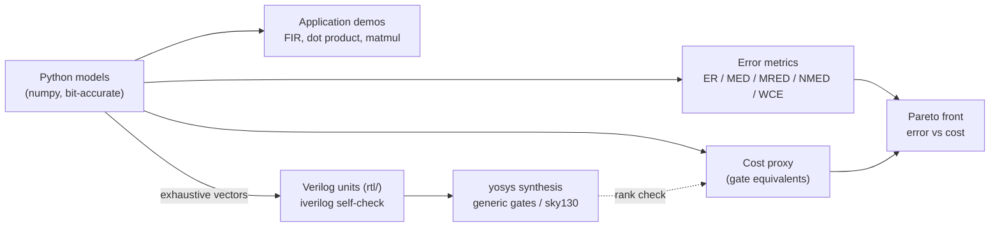

# ApproxKit

[](https://github.com/Kavin-Re/ApproxKit/actions/workflows/ci.yml)
[](LICENSE)


Bit-accurate Python models, error metrics, a Pareto design-space explorer and matching
Verilog for approximate adders and multipliers. Every Verilog unit is checked against its
Python model over **all** operand pairs, and every Python model against an independent
bit-level reference.



## Install and quick start

```bash
pip install -e .            # needs numpy; add ".[plots]" for matplotlib, ".[test]" for pytest
```

```python
import numpy as np, approxkit as ak

add = ak.LOA(8, k=3)                  # 8-bit lower-part-OR adder, 3 approximate bits
mul = ak.DRUM(8, k=4)                 # 8-bit DRUM with 4-bit segments
add(200, 100), mul(np.array([13, 200]), np.array([9, 77]))   # numpy-vectorised, unsigned

m = ak.evaluate(mul)                  # exhaustive for n <= 12, Monte Carlo above
m.ER, m.MED, m.MRED, m.NMED, m.WCE    # definitions below
counts, edges = m.histogram(bins=61)  # signed-error distribution
mul.area_ge()                         # gate-equivalent PROXY (not synthesized area)

ak.make("multiplier", "booth", 16, k=10)   # factory by family name
```

```bash
python examples/run_dse.py --n 8            # sweep + Pareto plots + CSV (use --n 16 for Monte Carlo)
python examples/demo_apps.py                # FIR / dot product / matmul accuracy
python -m pytest                            # unit tests (core + v2)
python scripts/rtl_regress.py --out build --synth    # RTL vs model; needs iverilog (and yosys for --synth)
```

## Repository layout

| Path | Contents |
|---|---|
| `approxkit/` | The installable library: `adders.py`, `multipliers.py`, `metrics.py`, `cost.py`, `dse.py`, `apps.py`, `plotting.py` |
| `rtl/` | Verilog-2001 implementation of every unit, one module per file |
| `tests/` | Scalar bit-level reference models, metric and Pareto checks |
| `scripts/` | `rtl_regress.py` (models -> exhaustive vectors -> iverilog self-check -> optional yosys), `compare_csv.py` |
| `examples/` | `run_dse.py`, `demo_apps.py` |
| `results/` | CSVs, plots and logs produced by the runs reported below |
| `v2/` | Follow-on study built on top of the library: signed multipliers, dividers, reciprocal, squarers, FPGA-flow cost ranking, image/FIR quality. Separate package `approxkit_v2`, own RTL, tests and results. See [`v2/README.md`](v2/README.md) |

`approxkit/` is the stable, unsigned core. `v2/` imports it unchanged and is run from the
source tree; it is not part of the installed package.

## Units

All units are unsigned. Adders map n-bit operands to n+1 bits; multipliers n x n to 2n bits.
The definitions below are bit-exact and identical in Python and Verilog.

| Class | Parameters | Definition |
|---|---|---|
| `ExactAdder`, `ExactMultiplier` | n | References |
| `LOA` | k | Low k sum bits = a OR b; carry into the exact upper part = a[k-1] AND b[k-1] |
| `TruncatedAdder` | k | Upper n-k bits added exactly, low k result bits = 0, no carry from the low part |
| `ETA` (ETA-I flavour) | k | Upper part exact with no carry-in; low part scanned from bit k-1 down: sum = a XOR b until the first bit where a = b = 1; that bit and all lower bits become 1 |
| `GeAr` (ACA-style for R = 1) | R, P | Sub-adders of length L = R + P, each producing R new bits from P predictor bits (carry-in speculated 0); last block anchored at the MSB; L = n is exact |
| `AMA` | k, cell | Low k bits use a simplified full-adder cell (`sum_b`: Sum = b, Cout = a; `inv_carry`: Cout = majority, Sum = NOT Cout). These two cells are this project's own, in the spirit of mirror-adder approximations, not copies of a published cell |
| `TruncatedMultiplier` | k | Partial-product bits in columns < k dropped, no compensation |
| `BrokenArray` | vbl, hbl | Rows i < hbl and columns < vbl dropped, the rest summed exactly |
| `DRUM` | k | k-bit segment from the leading one, LSB forced to 1 if bits were discarded; exact k x k product shifted back; operands < 2^k are exact |
| `Mitchell` | - | log2 x ~ K + f, added in fixed point (n-1 fraction bits), linear antilog, floor. Always underestimates |
| `BoothApprox` | k | Radix-4 Booth (n//2 + 1 digits for unsigned input); each partial-product *magnitude* has columns < k cleared, then is negated if the digit is negative; sum modulo 2^2n (k = 0 is exact) |

Constraints: `0 <= k <= n-1` for adders (Verilog: `1 <= K <= N-1`), `2 <= n <= 31` (int64
arithmetic). Non-integer or out-of-range parameters raise `ValueError`. For signed operands
use the sign-magnitude wrapper `approxkit.apps.signed_mul`, or the native signed units in `v2/`.

## Error metrics

With e = approx - exact over the evaluated operand pairs (uniform inputs):

| Metric | Definition |
|---|---|
| ER | P(e != 0) |
| MED | mean \|e\| |
| MRED | mean \|e\| / exact, over pairs with exact != 0 |
| NMED | MED / maximum exact output: 2(2^n - 1) for adders, (2^n - 1)^2 for multipliers |
| WCE | max \|e\| |
| bias, RMSE | mean e (signed), root mean square of e |

Evaluation is exhaustive for n <= 12 (n <= 14 can be forced), otherwise Monte Carlo
(default 2^20 seeded uniform pairs). A Monte-Carlo WCE is only a *lower bound* on the true
worst case. Uniform operands are rarely the distribution of a real application: evaluate on
your own operand statistics before trusting MRED/NMED for a design.

## Cost model (a proxy)

`approxkit/cost.py`: NAND2 = 1 GE, AND/OR 1.5, XOR 2.5, MUX 2.5, HA 4, FA 9.5. Adders are
ripple structures; multipliers use carry-save bit counting (#FA = kept partial-product bits
minus active columns); shifters and leading-one detectors are heuristics.
**This is a ranking proxy, not synthesized area**: no wiring, timing or sizing.
`delay_levels()` gives the longest carry chain for adders. The proxy is known to be wrong for
some structures: it understates Mitchell's shifters and ETA's control logic and overstates
GeAr's cost for small overlaps. The synthesis cross-check is below.

`dse.pareto_front(rows, cost_key, err_key)` returns the non-dominated designs when minimising
both keys, sorted by increasing cost.

## Results

All numbers below come from files in `results/`; nothing is quoted from the literature.

**Tests.** `python -m pytest`: 28 tests (13 core, 15 v2). Every unit is compared with an
independent scalar bit-level reference over all operand pairs at n = 6 and on random and corner operands at n = 16, 24 and 31, plus exactness
limits, known values, parameter validation, metrics against brute force, Monte Carlo against
exhaustive, a brute-force non-dominance check of the Pareto front, and the application demos.

**Verilog vs Python (iverilog 12.0, exhaustive).** `scripts/rtl_regress.py`: 173/173 cases
pass (61 configurations at n = 8 and the same families at n = 7 and n = 5; all 2^(2n)
operand pairs compared bit-for-bit, including odd widths and non-divisible GeAr windows).
The testbench was confirmed to fail on deliberately broken RTL (two mutations tried).
Log: `results/rtl_regress.log`.

**Synthesis (yosys 0.33, n = 8, `synth -flatten` then `abc`).** `results/rtl_synth_n8.csv`
holds, per design, the generic-gate count, its GE-weighted sum (same weights as the proxy)
and the cell area after mapping to a sky130 high-density liberty (yosys + abc only: no place
and route, no timing). These are *synthesis estimates, not silicon area*. Spearman rank
agreement between proxy and synthesis: 0.94 (adders) / 0.92 (multipliers) against sky130
area, 0.70 / 0.88 against generic gate counts.

Caveat: `bam_mult`, `trunc_mult` and `booth_mult` accumulate partial products with a
sequential chain of `+`, whereas `exact_mult` uses `*` (yosys builds a carry-save structure).
The fair baseline for those three is `bam_mult` with VBL = 0, HBL = 0 (2054 um^2), not
`exact_mult` (1927 um^2). A hand-built compressor tree would shift every multiplier number.

**Pareto highlights, n = 8, exhaustive** (area: sky130 synthesis estimate):

| Design | MRED | NMED | sky130 area (um^2) | Exact reference (um^2) |
|---|---:|---:|---:|---|
| LOA k=2 | 0.34 % | 0.12 % | 184 | exact adder 208 |
| ETA k=2 | 0.37 % | 0.13 % | 168 | |
| LOA k=4 | 1.5 % | 0.56 % | 141 | |
| Truncated mult k=6 | 2.6 % | 0.12 % | 1292 | adder-chain array 2054 |
| Truncated mult k=8 | 9.8 % | 0.69 % | 905 | |
| Booth-approx k=8 | 4.8 % | 0.24 % | 1132 | |
| DRUM-4 | 5.9 % | 1.4 % | 1295 | |
| DRUM-6 | 1.3 % | 0.36 % | 1647 | |
| Mitchell | 3.8 % | 0.93 % | 1848 | no saving at n = 8 |

Findings at n = 8:

* **Multipliers.** The best low-error designs on both the proxy and the synthesized area are
  the column-truncation / broken-array / Booth-approx family. DRUM reaches the synthesized
  Pareto front only at isolated points (k = 2, 6, 7). Mitchell gives no area benefit at 8
  bits in this implementation (its barrel shifters and detectors cost about as much as the
  exact multiplier), although its relative error is data-independent and one-sided.
* **Adders.** LOA and ETA win at small k. The `sum_b` AMA cell is cheapest at larger k but
  errs on almost every input (ER ~ 94 % at k = 4). ETA and LOA have similar MRED at equal k,
  but ETA's worst-case error is about twice LOA's at k = 4 and its control chain costs more.
* **GeAr buys delay, not area.** Its carry chain is L bits, but its cost exceeds the exact
  ripple adder, and a missed carry is a large (2^L-scale) error.

Full sweeps: `results/dse_*_n8.csv` (exhaustive) and `results/dse_*_n16.csv` (Monte Carlo,
2^20 samples, seed 0); Pareto plots `results/pareto_*.png`; histograms `results/errhist_*.png`.
The n = 8 CSVs are regenerated and compared in CI.

**Application demos** (`results/apps_*.csv`, 8-bit multipliers; 31-tap FIR on a noisy
two-tone signal, 256-term dot products, 16 x 16 uint8 matmul; accuracy against exact):
Mitchell gives 31 dB FIR SNR (dot-product relative RMS 5 %, matmul 3.4 %); truncated k = 1
gives 66 dB; DRUM-2 only 9.8 dB. With an exact multiplier and 24-bit accumulators, LOA k = 4
gives 47 dB FIR SNR against 43.5 dB for truncated / ETA k = 4, and GeAr(R=4, P=8) is very
poor on dot products (relative RMS 0.49) because missed carries are large. FIR operands
here span only 7 bits, so DRUM-7 is trivially exact. Signed data is handled by passing
magnitudes through the unsigned unit and accumulating positive and negative terms
separately; `v2/RESULTS_V2.md` section 5 shows that this organisation makes ETA and
truncation accumulators produce identical results, and repeats the comparison with a single
two's-complement accumulator.

## Verilog (`rtl/`)

`exact_adder`, `loa_adder`, `trunc_adder`, `eta_adder`, `gear_adder`, `ama_adder`,
`exact_mult`, `bam_mult`, `trunc_mult`, `drum_mult`, `mitchell_mult`, `booth_mult`.

All modules have ports `a`, `b`, `y` and parameter `N` plus the unit parameters above in
upper case. Plain Verilog-2001 (`$clog2`), purely combinational, written for clarity rather
than timing; the multipliers use behavioural `for` loops and `+` chains that synthesis tools
restructure.

```bash
python scripts/rtl_regress.py --out build [--widths 8,7,5] [--no-sim] [--synth] [--liberty file.lib]
```

## Limitations

* The core library is unsigned; signed operation uses sign-magnitude wrappers whose extra
  hardware is not modelled (native signed units are in `v2/`).
* Cost is a proxy. Do not quote GE or the sky130 numbers as area for an FPGA flow: carry
  chains and LUT mapping change the picture entirely (an exact adder is already fast and
  cheap on an FPGA, and many approximations save nothing). Synthesize on the actual target.
  `v2/RESULTS_V2.md` section 3 quantifies how weakly LUT counts track sky130 area.
* No delay or power model beyond the adder carry-chain length.
* Metrics assume uniform, independent operands.
* The Booth unit uses this project's own sign-magnitude truncation and the two `AMA` cells
  are this project's own. The other units follow the usual descriptions of each technique,
  but published variants differ in details (for example compensation constants), so numbers
  will not match published tables.
* RTL equivalence was run at n = 5, 7 and 8 only. Wider instances (n = 16, 24, 31) are
  checked in Python against arbitrary-precision references on random and corner operands,
  not by simulation.

## Related work in this account

ApproxKit is an independent, general-purpose library. It shares its subject with
my approximate-SAD research project
(approximate 4:2-compressor SAD units for video motion estimation; repository private until publication) but no code: there are no
compressor or SAD models here.

## References

* J. N. Mitchell Jr., "Computer Multiplication and Division Using Binary Logarithms",
  *IRE Transactions on Electronic Computers*, 1962.
* S. Hashemi, R. I. Bahar, S. Reda, "DRUM: A Dynamic Range Unbiased Multiplier for
  Approximate Applications", ICCAD 2015.

The remaining techniques (lower-part-OR adders, error-tolerant adders, generic
accuracy-configurable / almost-correct adders, mirror-adder approximations, broken-array
multipliers, approximate Booth multipliers) are implemented from their standard textbook
descriptions; consult the original papers before comparing numbers.

## License

Released under the [MIT License](LICENSE).
